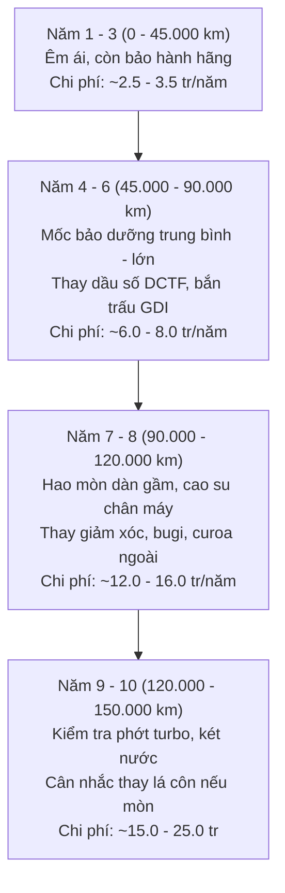

# BÁO CÁO THẨM ĐỊNH KỸ THUẬT: ĐỘ BỀN ĐỘNG CƠ & HỘP SỐ FORD TERRITORY (2025) TRONG VÒNG ĐỜI 8 – 10 NĂM

> **Hội đồng Thẩm định:** Kỹ thuật Động lực học & Giám định Xe Cơ giới  
> **Đối tượng thẩm định:** Động cơ 1.5L EcoBoost (JX4G15C6L) & Hộp số 7 cấp ly hợp kép ướt Magna (7DCT300)  
> **Thời gian dự kiến sử dụng:** 8 – 10 năm (Tương đương 120.000 – 180.000 km)  
> **Bản HTML Visual Dashboard:** [research/do-ben-dong-co-hop-so-ford-territory/index.html](file:///Users/mac/Desktop/Brain/research/do-ben-dong-co-hop-so-ford-territory/index.html)

---

## ⚡ CÂU TRẢ LỜI DỨT KHOÁT TỪ CHUYÊN GIA

> **CÓ THỂ YÊN TÂM DÙNG 8 – 10 NĂM (150.000 – 200.000 KM), NHƯNG ĐÂY KHÔNG PHẢI MẪU XE DÀNH CHO NGƯỜI LƯỜI BẢO DƯỠNG.**

1. **Về Động cơ (1.5L EcoBoost - JX4G15):** Sử dụng **XÍCH CAM KIM LOẠI (Timing Chain)**, bôi trơn bằng dầu động cơ. **TUYỆT ĐỐI KHÔNG DÙNG curoa cam ngâm dầu (Wet Belt)** như thế hệ EcoBoost 1.0L tai tiếng trước đây. Cơ khí máy cực kỳ bền, hoàn toàn chịu được 10 năm nếu thay dầu tổng hợp định kỳ.
2. **Về Hộp số (Magna 7DCT300):** Sử dụng **LY HỢP KÉP DẠNG ƯỚT (Wet Dual-Clutch)** do tập đoàn Magna (Đức/Canada) sản xuất (dùng chung trên BMW 1-Series, 2-Series, MINI, Mercedes A-Class). Khác hoàn toàn hộp số khô PowerShift thảm họa trên Focus/Fiesta cũ. Ngâm ngập trong dầu làm mát nên không bị quá nhiệt cháy côn.
3. **Điều kiện tiên quyết sống còn để xe bền 8 – 10 năm:**
   - Thay dầu hộp số ly hợp kép chuyên dụng (DCTF) mỗi **40.000 – 50.000 km** (tối đa 60.000 km).
   - Vệ sinh muội than xúp-páp nạp (do dùng phun trực tiếp GDI) ở mốc **60.000 – 80.000 km**.
   - Chuẩn bị sẵn ngân sách ~25 – 35 triệu đồng ở **năm thứ 7 – 9** để đại tu cụm cao su gầm, bảo dưỡng hệ thống làm mát và thay gói lá côn ly hợp nếu bị mòn tự nhiên.

---

## PHẦN 1: MỔ XẺ CHI TIẾT ĐỘNG CƠ 1.5L ECOBOOST (JX4G15)

### 1. Nguồn gốc & Bản chất cơ khí
* **Đơn vị phát triển:** Liên doanh Jiangling Motors Corporation (JMC) & Ford Motor Company, thừa hưởng nền tảng động cơ Dragon/EcoBoost toàn cầu kết hợp tư vấn thiết kế cơ khí của AVL (Áo).
* **Kết cấu xy-lanh:** 4 xy-lanh thẳng hàng (I4), dung tích 1.490 cc. Khác với dòng EcoBoost 3 xy-lanh (I3) thường bị rung giật chân máy sau 3–4 năm, động cơ 4 xy-lanh của Territory có độ cân bằng thứ cấp và khử rung động rất tốt.
* **Cơ cấu dẫn động trục cam:** Sử dụng **xích cam kim loại độ bền cao** kèm bộ tăng xích thủy lực tự động. Tuổi thọ thiết kế của xích cam tương đương tuổi thọ động cơ (250.000 – 300.000 km), không cần định kỳ thay thế như dây curoa cao su.

### 2. Hai điểm cần lưu ý kỹ thuật sau 5 – 8 năm
* **Vấn đề 1: Đóng muội than xúp-páp nạp (Carbon Buildup on Intake Valves):**
  - Động cơ ứng dụng công nghệ **Phun xăng trực tiếp (GDI)** áp suất cao vào thẳng buồng đốt.
  - *Điểm yếu vật lý của mọi động cơ GDI:* Xăng không đi qua cổ hút nên không có tác dụng "tẩy rửa" muội than bám ở nấm xúp-páp nạp (nguồn từ khí tuần hoàn EGR và hơi dầu PCV).
  - *Hệ quả:* Sau 60.000 – 80.000 km (khoảng năm thứ 4–5), xúp-páp nạp sẽ đóng lớp muội than dày, gây hiện tượng xe hụt ga đầu, rung nhẹ khi nổ không tải (Garanti) và tốn thêm 5–8% xăng.
  - *Cách khắc phục:* Bắt buộc định kỳ làm dịch vụ **Bắn trấu vệ sinh họng nạp (Walnut Blasting)** với chi phí khoảng 2.000.000 – 3.000.000 VNĐ.
* **Vấn đề 2: Tuổi thọ cụm Turbo tăng áp (Turbocharger):**
  - Cụm tăng áp trên Territory do Garrett/BorgWarner cung ứng, quay ở tốc độ trên 150.000 vòng/phút và chịu nhiệt độ khí xả trên 800°C.
  - *Tuổi thọ dự kiến:* **150.000 – 200.000 km** (tương đương 8 – 10 năm).
  - *Rủi ro:* Nếu dùng dầu nhớt kém chất lượng hoặc quên thay dầu, đường dầu bôi trơn trục turbo sẽ bị đóng cặn than (coking), làm mòn bạc đạn và xì phớt dầu turbo. Khi đó chi phí phục hồi/thay mới turbo khoảng 15 – 22 triệu đồng.

---

## PHẦN 2: MỔ XẺ HỘP SỐ LY HỢP KÉP ƯỚT MAGNA 7DCT300

### 1. Tại sao 7DCT300 KHÔNG PHẢI là "thảm họa PowerShift"?
Rất nhiều người tiêu dùng Việt Nam ám ảnh với hộp số ly hợp kép của Ford do scandal hộp số **PowerShift (DPS6)** khô trên Fiesta/Focus giai đoạn 2012–2016. Tuy nhiên, 7DCT300 là một câu chuyện hoàn toàn khác:

| Tiêu chí kỹ thuật | PowerShift cũ (DPS6) | Magna 7DCT300 trên Territory |
| :--- | :--- | :--- |
| **Kiểu ly hợp** | **Ly hợp kép KHÔ (Dry Clutch)** | **Ly hợp kép ƯỚT (Wet Clutch)** |
| **Cơ chế tản nhiệt** | Tản nhiệt tự nhiên bằng không khí | **Ngâm ngập trong dầu làm mát chuyên dụng** |
| **Khả năng chịu nhiệt kẹt xe** | Dễ bị quá nhiệt >200°C làm cháy côn, giật cục | **Dầu tuần hoàn liên tục qua két giải nhiệt** |
| **Nhà sản xuất** | Getrag đời đầu hợp tác Ford | **Magna Powertrain (Thế hệ thứ 3 hiện đại)** |
| **Xe sử dụng chung** | Ford Focus, Fiesta, EcoSport | **BMW 1-Series, 2-Series, MINI Cooper, Renault, Mercedes A-Class** |
| **Giới hạn mô-men xoắn** | 250 Nm (Chạy kịch khung) | **300 – 320 Nm** (Territory chỉ dùng 248 Nm $\rightarrow$ **Dư tải 20%**) |

### 2. Hiện tượng vận hành bình thường (Không phải lỗi hỏng)
* **Giật nhẹ/khựng giữa số 1 và số 2 khi bò tắc đường:** Đây là bản chất cơ học của mọi loại hộp số ly hợp kép (kể cả DSG của Volkswagen hay PDK của Porsche). Khi tài xế rà phanh nhấp nhả ở tốc độ 5–15 km/h, bộ vi xử lý TCU dự đoán tài xế sắp tăng tốc (chuẩn bị số 2) nhưng tài xế lại đột ngột phanh lại, khiến hộp số phải vội vã chuyển lại số 1, tạo ra cú khựng nhẹ.
* **Tiếng "tách" cơ khí nhỏ khi chuyển D sang R:** Là âm thanh của càng cua thủy lực gài bánh răng trong hộp số, hoàn toàn bình thường.

### 3. Tuổi thọ lá côn & Cụm điều khiển thủy lực (Mechatronics)
* **Tuổi thọ lá côn ly hợp ướt:** Thiết kế đạt **200.000 – 250.000 km**. Khác với côn khô bị mòn sau 6–8 vạn km, côn ướt có màng dầu bảo vệ bề mặt vật liệu ma sát nên mức độ mòn cực kỳ chậm.
* **Cụm Mechatronics (vỉ van thủy lực & van điện từ Solenoid):**
  - Là bộ não điều khiển đóng mở côn và chuyển số.
  - *Rủi ro sau 7 – 10 năm:* Dầu hộp số cũ bị thoái hóa sẽ chứa các mạt kim loại li ti làm kẹt van điện từ hoặc chập mạch cảm biến nhiệt/tốc độ.
  - *Phòng ngừa:* **Bắt buộc thay dầu DCTF mỗi 40.000 – 50.000 km**. Tuyệt đối không để dầu chạy quá 60.000 km.

---

## PHẦN 3: LỘ TRÌNH KỸ THUẬT & DỰ TOÁN BẢO DƯỠNG TRONG 10 NĂM

Giả định tần suất sử dụng gia đình bình quân: **15.000 km/năm**:

### Bảng dự toán chi phí nuôi xe theo từng mốc thời gian:

| Giai đoạn | Các hạng mục kỹ thuật trọng yếu | Chi phí ước tính | Mức độ rủi ro |
| :--- | :--- | :---: | :---: |
| **Giai đoạn 1 (Năm 1 – 3)**  *(0 – 45.000 km)* | - Thay dầu máy tổng hợp 5W-30 + Lọc dầu mỗi 8.000 km.  - Lọc gió động cơ, lọc gió điều hòa.  - Nằm trong thời hạn bảo hành chính hãng (đến 2028). | **~3.000.000 VNĐ / năm** | 🟢 Cực thấp (An tâm 100%) |
| **Giai đoạn 2 (Năm 4 – 6)**  *(45.000 – 90.000 km)* | - **Thay dầu hộp số ly hợp kép DCTF (Mốc 5 vạn km)**.  - Bắn trấu vệ sinh muội than xúp-páp nạp GDI.  - Thay dầu phanh, nước làm mát động cơ, bugi Iridium.  - Thay 4 quả lốp mới. | **~8.000.000 – 12.000.000 VNĐ / năm** | 🟡 Trung bình (Cần tuân thủ đúng định kỳ) |
| **Giai đoạn 3 (Năm 7 – 8)**  *(90.000 – 120.000 km)* | - Thay dàn giảm xóc (phuộc trước/sau do giảm xóc Territory khá mềm).  - Thay cao su càng A, rô-tuyn cân bằng, cao su chân máy.  - Thay đai curoa tổng truyền động bên ngoài.  - Cập nhật phần mềm TCU/ECU. | **~15.000.000 – 18.000.000 VNĐ** | 🟡 Hao mòn gầm bệ tự nhiên |
| **Giai đoạn 4 (Năm 9 – 10)**  *(120.000 – 150.000 km)* | - Kiểm tra phớt dầu trục Turbo, ống dẫn cao áp.  - Súc rửa két nước giải nhiệt, thay van hằng nhiệt, bơm nước.  - **Thay bộ lá côn ướt hộp số (nếu có dấu hiệu trượt côn)**. | **~20.000.000 – 30.000.000 VNĐ** *(Gói đại tu làm mới)* | 🟠 Cần xưởng chuyên môn uy tín |

---

## PHẦN 4: 5 NGUYÊN TẮC VÀNG ĐỂ TERRITORY BỀN BỈ 10 NĂM

1. **Không tin vào khái niệm "Dầu hộp số bôi trơn trọn đời":** Các hãng xe thường ghi dầu số trọn đời để giảm chi phí bảo trì trên giấy tờ. Với hộp số DCT ướt vận hành ở khí hậu nhiệt đới nắng nóng tại Đà Nẵng, **bắt buộc phải thay dầu hộp số DCTF ở mốc 40.000 – 50.000 km**.
2. **Thói quen dừng đèn đỏ đúng chuẩn:** Khi dừng đèn đỏ quá 30 giây hoặc kẹt xe đứng yên, hãy **về N và kéo phanh tay** (hoặc dùng Auto Hold đúng cách). Tránh việc giữ số D rồi rà phanh nhấp nhả làm bộ ly hợp liên tục ở trạng thái cọ sát sinh nhiệt.
3. **Chăm sóc cụm Turbo:** Sau khi chạy tốc độ cao trên cao tốc La Sơn - Túy Loan hoặc leo dốc đèo Hải Vân về, không nên tắt máy ngay lập tức. Hãy để xe nổ không tải (Idling) trong 45 – 60 giây để dầu máy kịp giải nhiệt cho trục turbo trước khi ngừng quay.
4. **Luôn dùng dầu nhớt động cơ đạt chuẩn Ford:** Động cơ EcoBoost có khe hở nhiệt khít và dùng xích cam, chỉ nên dùng dầu tổng hợp toàn phần độ nhớt **5W-30 chuẩn Ford WSS-M2C913-D hoặc WSS-M2C948-B** (ví dụ Castrol Magnatec Professional, Mobil 1, Motul).
5. **Đổ xăng chuẩn A95 (RON 95):** Tuyệt đối không đổ xăng E5 RON 92. Tỷ số nén của động cơ Turbo cao, dùng xăng chỉ số octan thấp rất dễ gây kích nổ (knocking) làm hỏng pít-tông và xúp-páp.

---

## 🎯 KẾT LUẬN THẨM ĐỊNH

| Hạng mục | Đánh giá độ bền 8 – 10 năm | Điểm số độ tin cậy |
| :--- | :--- | :---: |
| **Cơ khí lốc máy & Xích cam** | Siêu bền, xích kim loại không lo đứt curoa | **9.0 / 10** |
| **Hộp số Magna 7DCT300** | Cực kỳ bền nếu thay dầu đúng hạn; mượt mà hơn số khô | **8.5 / 10** |
| **Cụm Turbo tăng áp** | Đạt 150.000 – 200.000 km nếu dùng dầu nhớt xịn | **8.0 / 10** |
| **Hệ thống điện & Màn hình** | Rủi ro chập chờn sau năm thứ 7 do khí hậu nóng ẩm | **7.5 / 10** |
| **Khung gầm & Giảm xóc** | Giảm xóc mềm, cần thay thế phuộc ở năm thứ 5 – 6 | **7.5 / 10** |

👉 **LỜI KHUYÊN CUỐI CÙNG:** Bạn **HOÀN TOÀN CÓ THỂ YÊN TÂM CHỌN FORD TERRITORY TITANIUM X 2025 ĐỂ DÙNG 8 – 10 NĂM**, với điều kiện bạn là người chủ xe có trách nhiệm, tuân thủ đúng lịch thay dầu hộp số và vệ sinh họng nạp GDI. Khối cơ khí JX4G15 + Magna 7DCT300 đã là cấu hình trưởng thành, loại bỏ hoàn toàn các lỗi chí mạng của thế hệ Ford cũ.
