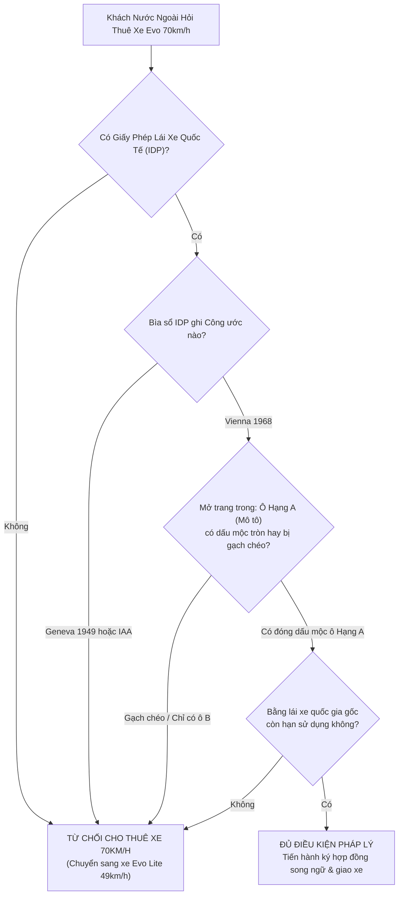

# BÁO CÁO THẨM ĐỊNH CHUYÊN SÂU PHÁP LÝ: CHO NGƯỜI NƯỚC NGOÀI THUÊ XE MÁY ĐIỆN VINFAST EVO (BẢN TIÊU CHUẨN ĐẠT VẬN TỐC 70 KM/H)

> **Mã hồ sơ pháp lý:** `LOKI-VINFAST-EVO-70KMH-LEGAL-2026`  
> **Phương tiện thẩm định:** Xe máy điện VinFast Evo / Evo200 (Bản Tiêu chuẩn, tốc độ tối đa 70 km/h ở chế độ Sport)  
> **Căn cứ pháp lý:**  
> - Luật Trật tự, an toàn giao thông đường bộ số 36/2024/QH15 (hiệu lực từ 01/01/2025).  
> - Điều 264 Bộ luật Hình sự 2015 (sửa đổi, bổ sung 2017) về tội Giao cho người không đủ điều kiện điều khiển phương tiện tham gia giao thông đường bộ.  
> - Điều 601 Bộ luật Dân sự 2015 về Bồi thường thiệt hại do nguồn nguy hiểm cao độ gây ra.  
> - Nghị định 100/2019/NĐ-CP & Nghị định 123/2021/NĐ-CP về xử phạt vi phạm hành chính lĩnh vực giao thông.  
> - Nghị định 67/2023/NĐ-CP về bảo hiểm bắt buộc trách nhiệm dân sự của chủ xe cơ giới.  
> - Thông tư 29/2015/TT-BGTVT quy định về cấp, sử dụng Giấy phép lái xe quốc tế (IDP).  
> **Bản tương tác trực quan (Interactive Visual Report):** [`index.html`](file:///Users/mac/Desktop/Brain/research/phap-ly-thue-xe-dien-vinfast-evo-70kmh-nguoi-nuoc-ngoai/index.html)

---

## TỔNG QUAN PHÁN QUYẾT PHÁP LÝ (EXECUTIVE LEGAL VERDICT)

> [!CAUTION]
> **CẢNH BÁO MỨC ĐỘ NGUY HIỂM TỐI CAO:**  
> Dòng xe **VinFast Evo đạt vận tốc 70 km/h** pháp luật xác định là **Xe mô tô hai bánh**, người điều khiển **BẮT BUỘC PHẢI CÓ GIẤY PHÉP LÁI XE HẠNG A1 (hoặc hạng A mới)**.  
> Nếu chủ xe cho người nước ngoài thuê mà **không kiểm tra và lưu giữ bằng lái hợp lệ theo Công ước Vienna 1968 (có đóng dấu Hạng A mô tô)**, khi khách gây tai nạn chết người hoặc thương tật $\ge 61\%$, **CHỦ XE SẼ BỊ KHỞI TỐ HÌNH SỰ THEO ĐIỀU 264 BỘ LUẬT HÌNH SỰ (PHẠT TÙ TỪ 6 THÁNG ĐẾN 7 NĂM)!**  
> *Đã có 2 chủ cơ sở cho thuê xe tại Đà Nẵng (quận Ngũ Hành Sơn và quận Sơn Trà) bị TAND TP Đà Nẵng kết án phạt 12 tháng cải tạo không giam giữ trong năm 2024 vì lỗi này.*

---

## PHẦN 1: BẢN CHẤT KỸ THUẬT & PHÂN LOẠI PHƯƠNG TIỆN THEO LUẬT 2024

### 1.1. Thông Số Kỹ Thuật Chính Thức Của VinFast Evo (Bản 70 km/h)
- **Vận tốc tối đa:** **70 km/h** (thử nghiệm với 1 người 65 kg ở chế độ Sport).
- **Công suất danh định:** 1.500 W.
- **Công suất tối đa:** Lên tới 2.450 W – 2.500 W.
- **Động cơ:** Inhub gắn trục bánh sau, khả năng tăng tốc 0 - 50 km/h trong 14 giây.

### 1.2. Phân Định Theo Luật Trật Tự, An Toàn Giao Thông Đường Bộ 2024 (Số 36/2024/QH15)
- **Khoản 18 & 19 Điều 2:** 
  * *Xe gắn máy:* Là phương tiện có vận tốc thiết kế lớn nhất **không quá 50 km/h** và công suất động cơ điện không quá 4 kW. (Đối tượng từ đủ 16 tuổi trở lên được phép lái, không cần bằng lái).
  * *Xe mô tô hai bánh:* Là xe có vận tốc thiết kế lớn nhất **trên 50 km/h** hoặc công suất động cơ điện trên 4 kW.
- **KẾT LUẬN:** Chiếc VinFast Evo này có vận tốc thiết kế 70 km/h &gt; 50 km/h &rarr; **XẾP VÀO NHÓM XE MÔ TÔ HAI BÁNH**.
- **Điều 57 (Hạng Giấy phép lái xe):** Người điều khiển xe mô tô hai bánh có công suất đến 11 kW hoặc dung tích đến 125cc **BẮT BUỘC PHẢI CÓ GIẤY PHÉP LÁI XE HẠNG A1** (hoặc hạng A mới theo luật 2024).

### 1.3. Ảo Tưởng Về "Chế Độ Eco Giới Hạn Tốc Độ"
Nhiều chủ xe lập luận: *"Tôi bàn giao xe và hướng dẫn khách chỉ bật nút Eco chạy dưới 45 km/h, không bật nút Sport, vậy xe có được coi là xe gắn máy không?"*
- **Câu trả lời pháp lý: TUYỆT ĐỐI KHÔNG!**
- Cơ quan Công an, CSGT, Viện kiểm sát và Tòa án khi xử lý vi phạm hoặc giám định tai nạn giao thông **căn cứ vào "Vận tốc thiết kế lớn nhất" (70 km/h)** được ghi trên Giấy chứng nhận chất lượng an toàn kỹ thuật của Cục Đăng kiểm Việt Nam và Giấy chứng nhận đăng ký xe (Cà-vẹt), hoàn toàn KHÔNG căn cứ vào công tắc cơ học Eco/Sport trên ghi-đông xe!

---

## PHẦN 2: HAI ÁN LỆ THỰC TẾ CỦA TAND TP ĐÀ NẴNG (XÉT XỬ NĂM 2024)

### Bản Án Số 1: Chủ Tiệm Nguyễn Quốc Đại (Quận Ngũ Hành Sơn, Đà Nẵng) — Xử Tháng 3/2024
- **Hành vi:** Ngày 23/2/2023, du khách quốc tịch Kyrgyzstan (29 tuổi) đến thuê xe máy tại cửa hàng của Nguyễn Quốc Đại. Khách đưa ra bằng lái xe nước ngoài. Đại không kiểm tra giá trị sử dụng tại Việt Nam (không có IDP Vienna 1968) mà vẫn làm hợp đồng cho thuê xe.
- **Hậu quả:** Du khách này điều khiển xe và gặp tai nạn giao thông tử vong tại ngã tư đường nội đô Đà Nẵng.
- **Tuyên án:** Tòa án nhân dân TP Đà Nẵng tuyên phạt bị cáo Nguyễn Quốc Đại **12 tháng cải tạo không giam giữ** về tội *"Giao cho người không đủ điều kiện điều khiển phương tiện tham gia giao thông đường bộ"* theo Điều 264 Bộ luật Hình sự.

### Bản Án Số 2: Chủ Tiệm Đặng Nguyễn Vũ (Quận Sơn Trà, Đà Nẵng) — Xử Tháng 6/2024
- **Hành vi:** Đặng Nguyễn Vũ kinh doanh cho thuê xe máy tại quận Sơn Trà. Vũ cho một nam du khách người Mỹ thuê xe máy dù biết khách Mỹ không có bằng lái xe hợp lệ tại Việt Nam (Mỹ dùng Geneva 1949).
- **Hậu quả:** Nam du khách người Mỹ va chạm trực diện với xe ô tô và tử vong tại chỗ.
- **Tuyên án:** TAND TP Đà Nẵng tuyên phạt Đặng Nguyễn Vũ **12 tháng cải tạo không giam giữ** theo Điều 264 Bộ luật Hình sự.

---

## PHẦN 3: MA TRẬN BẰNG LÁI QUỐC TẾ CỦA NGƯỜI NƯỚC NGOÀI

### 3.1. Các Trường Hợp Hợp Pháp (ĐƯỢC CHO THUÊ XE 70 KM/H)
Người nước ngoài chỉ được phép lái xe VinFast Evo 70 km/h khi thỏa mãn **MỘT TRONG HAI** điều kiện sau:
1. **Đã đổi sang Giấy phép lái xe Việt Nam hạng A1 (hoặc A):** Khách có thẻ tạm trú từ 3 tháng trở lên, nộp hồ sơ đổi bằng tại Sở GTVT. (Khách du lịch ngắn ngày 99.9% không có).
2. **Có Giấy phép lái xe quốc tế (IDP) cấp theo CÔNG ƯỚC VIENNA 1968:**
   - Sổ IDP còn thời hạn sử dụng.
   - Xuất trình kèm theo **Bằng lái xe quốc gia gốc** còn hạn.
   - **ĐIỀU KIỆN SỐNG CÒN:** Trên sổ IDP, tại trang phân hạng phương tiện, **PHẢI CÓ CON DẤU MỘC TRÒN TẠI Ô HẠNG A (MÔ TÔ HAI BÁNH)**.
   - *Các nước tham gia Vienna 1968:* Đức, Pháp, Ý, Tây Ban Nha, Ba Lan, Áo, Nga, Hàn Quốc, Hà Lan, Thụy Điển, Thụy Sĩ...

### 3.2. Các Trường Hợp Bất Hợp Pháp (CẤM TUYỆT ĐỐI CHO THUÊ XE 70 KM/H)
1. **Khách từ các nước dùng Công ước Geneva 1949:** Mỹ (bằng AAA), Úc, Canada, Anh, Nhật Bản, New Zealand. Việt Nam không tham gia Geneva 1949, do đó bằng IDP của các nước này **VÔ GIÁ TRỊ TẠI VIỆT NAM**.
2. **Bằng quốc tế mua online IAA (International Automobile Association):** Là giấy tờ dịch thuật do công ty tư nhân ở New York tự in bán online giá $40 - $70. Cục CSGT và Bộ GTVT khẳng định đây là bằng giả, không có giá trị pháp lý.
3. **Khách có IDP Vienna 1968 nhưng CHỈ TÍCH Ô HẠNG B (Ô TÔ):** Ở nước họ, khách chỉ thi bằng lái ô tô, ô xe máy (Hạng A) bị gạch chéo. Khách này **HOÀN TOÀN KHÔNG CÓ BẰNG LÁI XE MÁY**.
4. **Khách chỉ mang bằng lái nội địa bản xứ:** Bằng lái thẻ nhựa bằng tiếng Anh, tiếng Hàn... không có giá trị lái xe trực tiếp trên lãnh thổ Việt Nam.

---

## PHẦN 4: BỐN TẦNG TRÁCH NHIỆM NẶNG NỀ ĐÈ LÊN VAI CHỦ XE

### Tầng 1: Trách Nhiệm Hình Sự (Điều 264 BLHS 2015)
- Giao xe cho người không có bằng lái hợp lệ mà gây tai nạn làm chết từ 1 người, hoặc gây thương tật $\ge 61\%$, hoặc thiệt hại tài sản $\ge 100$ triệu:
  * Khoản 1: Phạt tiền 10 - 50 triệu hoặc cải tạo không giam giữ đến 3 năm.
  * Khoản 2: Phạt tù từ 6 tháng đến 3 năm (khi làm chết 2 người...).
  * Khoản 3: Phạt tù từ 2 năm đến 7 năm (làm chết 3 người trở lên...).

### Tầng 2: Trách Nhiệm Dân Sự (Điều 601 Bộ Luật Dân Sự 2015)
- Xe cơ giới là nguồn nguy hiểm cao độ. Giao xe trái pháp luật cho người không đủ điều kiện, chủ sở hữu xe phải **liên đới bồi thường toàn bộ thiệt hại** cho nạn nhân (tiền chữa bệnh, tổn thất tinh thần, tiền mai táng, chu cấp nuôi dưỡng con cái nạn nhân đến 18 tuổi).
- Nếu khách Tây tử vong hoặc bỏ trốn về nước, chủ xe phải gánh toàn bộ hàng trăm triệu đồng thi hành án dân sự.

### Tầng 3: Trách Nhiệm Hành Chính & Tạm Giữ Xe (Nghị Định 100 & 123)
- Phạt chủ xe từ 800.000đ đến 2.000.000đ (cá nhân) hoặc 1.600.000đ đến 4.000.000đ (tổ chức) lỗi giao xe cho người không có GPLX.
- Phạt người lái nước ngoài 1.000.000đ - 2.000.000đ lỗi không có GPLX.
- **Tạm giữ phương tiện 7 ngày.**

### Tầng 4: Bảo Hiểm Từ Chối Bồi Thường 100% (Khoản 2 Điều 7 Nghị Định 67/2023)
- Công ty bảo hiểm từ chối bồi thường cả TNDS lẫn vật chất xe máy nếu người điều khiển không có GPLX hợp lệ. Toàn bộ tiền bồi thường cho bên thứ ba và tiền sửa xe nát đầu chủ xe phải tự bỏ tiền túi.

---

## PHẦN 5: BỘ QUY TRÌNH THẨM ĐỊNH BẰNG LÁI 5 BƯỚC



1. **Bước 1:** Kiểm tra bìa sổ IDP &rarr; Bắt buộc phải có dòng chữ *"Convention on Road Traffic 1968"*. Nếu ghi 1949 hoặc IAA &rarr; Từ chối ngay.
2. **Bước 2:** Yêu cầu xuất trình thẻ bằng lái quốc gia gốc (National Driving License) còn hạn.
3. **Bước 3:** Mở trang áp chót của IDP &rarr; Kiểm tra ô Hạng A (Mô tô) có con dấu xác nhận hay không. Nếu chỉ đóng dấu ô Hạng B (Ô tô) &rarr; Từ chối ngay.
4. **Bước 4:** Chụp ảnh lưu trữ: Passport + Visa còn hạn + Trang bìa IDP + Trang đóng dấu Hạng A + Bằng gốc.
5. **Bước 5:** Khách ký điều khoản cam kết bằng lái hợp lệ và chịu trách nhiệm pháp lý bằng tiếng Anh.

---

## PHẦN 6: ĐIỀU KHOẢN HỢP ĐỒNG BẢO VỆ CHỦ XE BẰNG TIẾNG ANH

### Điều Khoản 1: Cam Đoan Bằng Lái Xe Mô Tô Hợp Pháp (Warranty of License)
```text
"REPRESENTATION OF LEGAL MOTORCYCLE QUALIFICATION: The Renter expressly warrants, represents, and certifies that the vehicle provided (VinFast Evo) is legally classified as an electric motorcycle with a maximum design speed of 70 km/h. The Renter confirms they currently possess a fully valid and unexpired International Driving Permit (IDP) issued strictly under the 1968 Vienna Convention on Road Traffic, with explicit endorsement for Class A (Motorcycles), accompanied by their original valid home-country motorcycle driving license. The Renter agrees that any false representation, expired status, or invalid license constitutes fraudulent breach of contract."
```

### Điều Khoản 2: Bồi Thường & Miễn Trừ Trách Nhiệm Chủ Xe (Hold Harmless)
```text
"COMPLETE INDEMNIFICATION AND ASSUMPTION OF LIABILITY: The Renter voluntarily assumes 100% of all civil, financial, and legal liabilities arising from any traffic accident, collision, personal injuries, death, or third-party property damage occurring during the rental period. The Renter hereby agrees to fully defend, indemnify, and hold harmless the Lessor/Owner against any claims, lawsuits, legal expenses, police fines, or civil compensation demands under Article 601 of the Vietnamese Civil Code."
```

---

## KẾT LUẬN & KIẾN NGHỊ CHIẾN LƯỢC

1. **Rủi ro quá lớn so với lợi nhuận:** Việc cho người nước ngoài thuê xe VinFast Evo 70 km/h là hành vi kinh doanh có độ rủi ro pháp lý cao nhất trong ngành cho thuê xe máy. Chỉ cần 1 du khách Mỹ hoặc Úc gây tai nạn tử vong, chủ tiệm sẽ bị khởi tố hình sự theo Điều 264 BLHS.
2. **Khuyến nghị vàng:** Nếu đối tượng khách hàng mục tiêu là du khách nước ngoài tại Đà Nẵng, **hãy chuyển đổi 100% sang dòng VinFast Evo Lite (giới hạn 49 km/h)**. Dòng xe này được pháp luật phân loại là xe gắn máy, người lái hoàn toàn không cần bằng lái, loại bỏ 100% rủi ro hình sự cho chủ xe, mở rộng tệp khách hàng lên gấp 3 lần và vận hành thanh thản, an tâm tuyệt đối!
