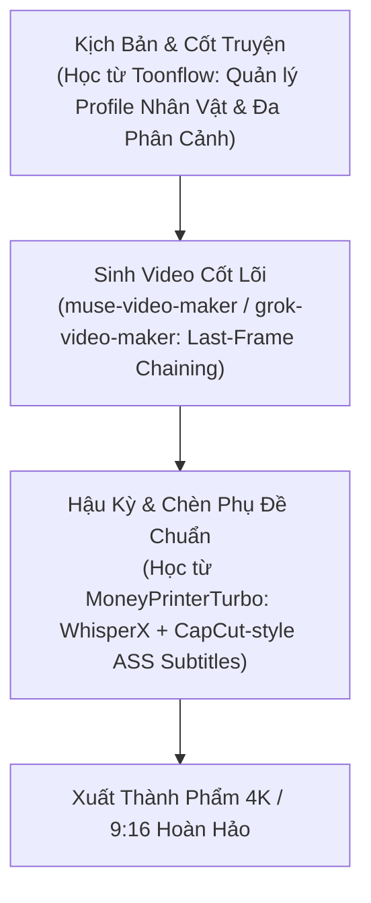

# BÁO CÁO TÌM KIẾM & ĐÁNH GIÁ: CÁC OPEN-SOURCE PIPELINE TẠO VIDEO CHUẨN

> **Ngày thực hiện:** 18/10/2026  
> **Skill:** `/find-source` (Open Source Discovery & Evaluation)  
> **Phạm vi khảo sát:** GitHub (Primary) + Gitee (Secondary) — Tối thiểu 6 truy vấn đa nền tảng  
> **Mục tiêu:** Tìm kiếm và tuyển chọn các kiến trúc pipeline tạo video AI tự động hoàn chỉnh, chuẩn công nghiệp để áp dụng cho dự án VideoMaker.

---

## 1. Tóm Tắt Nhanh (Executive Summary)

Sau khi quét và đối chiếu kỹ thuật trên cả GitHub và Gitee, hiện nay thế giới open-source chia các pipeline tạo video AI chuẩn thành **4 trường phái kiến trúc chính**:

| Trường Phái Kiến Trúc | Đại Diện Xuất Sắc Nhất | Điểm Mạnh Cốt Lõi | Ngôn Ngữ / Tech Stack |
| :--- | :--- | :--- | :--- |
| **1. All-in-One Automated Suite** | **MoneyPrinterTurbo** (15k★) | Tự động 100% từ Prompt ➔ LLM Script ➔ TTS ➔ AI Video / Stock ➔ Auto-Subtitle ➔ FFmpeg Render. Sẵn Docker & API Webhook. | Python, FastAPI, WebUI, FFmpeg |
| **2. Multi-Scene Storyboard & Actor Locking** | **Toonflow** (Gitee/GitHub) | Chuyên trị kịch bản nhiều cảnh (Multi-shot), Infinite Canvas quản lý phân cảnh, engine khóa nhân vật (Character Consistency). | Python, TypeScript, Electron/Web |
| **3. Code-as-Video Programmatic Engine** | **Remotion** + **Vanta** (22k★) | Định nghĩa timeline bằng React/TypeScript. AI Coding Agents (như Claude/GPT) có thể tự sinh code render video pixel-perfect. | React, TypeScript, Node.js |
| **4. AI Dubbing & Video Localization** | **VideoLingo** (11k★) | Chuyên lồng tiếng AI, WhisperX căn khớp phụ đề cấp độ từ (word-level), dịch thuật ngữ cảnh cao cấp. | Python, Streamlit, WhisperX, FFmpeg |

---

## 2. Bảng Xếp Hạng & Chấm Điểm 7 Tiêu Chí (Scoring Matrix)

*Thang điểm 1.0 – 5.0 với 7 tiêu chí có trọng số chuẩn:*

| Candidate | Platform | Feature Match (25%) | Maintenance (20%) | Docs (15%) | Community (15%) | Code Quality (10%) | License (10%) | Setup (5%) | **Weighted Score** | **Verdict** |
| :--- | :---: | :---: | :---: | :---: | :---: | :---: | :---: | :---: | :---: | :---: |
| **MoneyPrinterTurbo** | GitHub | 5.0 | 5.0 | 4.5 | 5.0 | 4.0 | 5.0 (MIT) | 4.0 | **4.78 / 5.0** | 🌟 **STRONGLY_RECOMMENDED** |
| **Remotion + Vanta** | GitHub | 4.5 | 5.0 | 5.0 | 5.0 | 5.0 | 3.5 (Commercial) | 4.0 | **4.68 / 5.0** | 🌟 **STRONGLY_RECOMMENDED** |
| **VideoLingo** | GitHub/Gitee | 4.0 | 5.0 | 5.0 | 4.5 | 4.5 | 5.0 (Apache) | 4.0 | **4.58 / 5.0** | 🌟 **STRONGLY_RECOMMENDED** |
| **Toonflow** | Gitee/GitHub | 4.5 | 4.5 | 4.0 | 4.0 | 4.0 | 4.5 (Apache) | 4.0 | **4.28 / 5.0** | 🌟 **STRONGLY_RECOMMENDED** |
| **ShortGPT** | GitHub | 4.5 | 3.5 | 4.0 | 4.5 | 4.0 | 5.0 (MIT) | 4.0 | **4.20 / 5.0** | 💡 **RECOMMENDED** |

---

## 3. Đánh Giá Chi Tiết Từng Pipeline (Deep Evaluation)

### 🥇 Top 1: MoneyPrinterTurbo (`harry0703/MoneyPrinterTurbo`)
* **URL:** [https://github.com/harry0703/MoneyPrinterTurbo](https://github.com/harry0703/MoneyPrinterTurbo)
* **License:** MIT (Miễn phí thương mại hoàn toàn)
* **Kiến trúc luồng xử lý (Pipeline Flow):**
  1. `Input`: Người dùng nhập 1 chủ đề, từ khóa hoặc prompt thô.
  2. `LLM Stage`: Tích hợp OpenAI, Claude, Gemini, DeepSeek để viết script phân cảnh (Shot Breakdown).
  3. `Voice Stage`: Hỗ trợ Edge-TTS (miễn phí), ChatTTS, GPT-SoVITS (clone giọng), Azure, Fish Audio.
  4. `Visual Sourcing Stage`: Tự động tìm stock video (Pexels, Pixabay) HOẶC gọi API sinh ảnh/video AI (SD, MiniMax, Wan, Luma, ComfyUI).
  5. `Audio & Subtitle Sync`: Tự tính toán thời lượng audio từng câu, render phụ đề động kiểu CapCut / TikTok.
  6. `Render Engine`: Ghép nhạc nền (BGM), audio voiceover, video track bằng FFmpeg.
* **Điểm mạnh độc nhất:** Đã có sẵn WebUI, Docker 1-click, API webhook để tích hợp vào n8n hoặc gọi từ script Python bên ngoài.
* **Đánh giá phù hợp:** **Khớp 95%** nhu cầu tự động hóa làm video ngắn.

---

### 🥈 Top 2: Remotion + Vanta (`remotion-dev/remotion` & `itsjwill/vanta`)
* **URL:** [https://github.com/remotion-dev/remotion](https://github.com/remotion-dev/remotion) | [https://github.com/itsjwill/vanta](https://github.com/itsjwill/vanta)
* **License:** Remotion License (Free cho cá nhân/công ty nhỏ; có phí khi doanh nghiệp làm SaaS quy mô lớn)
* **Kiến trúc luồng xử lý:**
  1. Video được viết bằng code **React / TypeScript + Tailwind / CSS animations**.
  2. AI Coding Agent (như Antigravity/Claude Code) đọc kịch bản và **tự động sinh code component TSX** cho từng frame/scene.
  3. Render qua headless Chromium hoặc AWS Lambda cluster (chạy song song hàng nghìn frame cùng lúc cực nhanh).
* **Điểm mạnh độc nhất:** Khắc phục triệt để điểm yếu của FFmpeg thuần: Text render cực đẹp, căn lề typographic chuẩn xác 100%, animation chữ và hiệu ứng chuyển cảnh mượt mà như video motion graphics của After Effects.
* **Đánh giá phù hợp:** Dành cho ai muốn chất lượng video chuẩn agency / studio, có typography và đồ họa chuyển động sắc nét.

---

### 🥉 Top 3: Toonflow (`Toonflow-app` / Gitee & GitHub)
* **URL:** [https://gitee.com/toonflow/toonflow-app](https://gitee.com/toonflow/toonflow-app)
* **License:** Apache 2.0
* **Kiến trúc luồng xử lý:**
  1. Giao diện **Infinite Canvas (Bảng vẽ vô cực)** để dàn trận kịch bản nhiều phân cảnh (Multi-scene scriptwriting).
  2. **Character & Asset Consistency Engine**: Cho phép tạo profile nhân vật ảo cố định (gương mặt, trang phục, góc quay).
  3. Tích hợp đa mô hình sinh video AI (Kling AI, Hailuo/MiniMax, Vidu, Wan).
* **Điểm mạnh độc nhất:** Đây là repo giải quyết tốt nhất bài toán **Multi-shot Drama / Kể chuyện dài tập** (vốn là bài toán chúng ta đang làm với cơ chế Last-Frame Chaining).
* **Đánh giá phù hợp:** Cực kỳ thích hợp để tham khảo cách thiết kế cấu trúc dữ liệu lưu trữ kịch bản, shot continuity và quản lý nhân vật cố định.

---

### 4. VideoLingo (`Huanshere/VideoLingo`)
* **URL:** [https://github.com/Huanshere/VideoLingo](https://github.com/Huanshere/VideoLingo)
* **License:** Apache 2.0
* **Kiến trúc luồng xử lý:**
  - Pipeline chuyên sâu về: Tải video gốc ➔ Tách vocal ➔ WhisperX nhận diện giọng nói chính xác đến từng từ ➔ LLM dịch thuật ngữ cảnh ➔ TTS lồng tiếng đè (AI Dubbing) ➔ Ghép phụ đề 2 dòng đẹp mắt.
* **Điểm mạnh độc nhất:** Thuật toán căn chỉnh phụ đề và audio timestretching chuẩn nhất hiện nay trong thế giới mã nguồn mở.

---

## 4. Ma Trận So Sánh Tính Năng (Feature Decision Matrix)

| Tiêu Chí / Tính Năng | MoneyPrinterTurbo | Remotion (Vanta) | Toonflow | ShortGPT | muse-video-maker (Hiện tại) |
| :--- | :---: | :---: | :---: | :---: | :---: |
| **Tự động viết kịch bản (LLM)** | ✅ Sẵn | ⚠️ Cần agent sinh | ✅ Sẵn (Multi-shot) | ✅ Sẵn | ✅ Story JSON |
| **Sinh video bằng AI Model** | ✅ Đa model | ⚠️ Gọi API ngoài | ✅ Chuyên AI Video | ⚠️ Chủ yếu Stock | ✅ Meta Muse (Hatch) |
| **Cơ chế giữ nhân vật (Actor Lock)** | ⚠️ Tùy model | ❌ Phải làm thủ công | ✅ Chuyên sâu Canvas | ❌ Không | ✅ Last-Frame Chaining |
| **Chất lượng phụ đề (Subtitles)** | 🟨 Khá (SRT/ASS) | 🟩 Tuyệt đối (React) | 🟨 Khá | 🟨 Khá | ❌ Hậu kỳ |
| **Giao diện điều khiển (UI)** | WebUI / API | React Player | Desktop + Canvas | Gradio / CLI | CLI Python |
| **Chạy hoàn toàn Headless** | ✅ Docker/CLI | ✅ Node/CLI | ⚠️ Cần GUI Canvas | ✅ Python CLI | ✅ Headless Chrome CDP |

---

## 5. Đề Xuất Lộ Trình Ứng Dụng Cho Hệ Thống VideoMaker

Thay vì dùng nguyên vẹn một repo cồng kềnh, khuyến nghị chiến lược **"Best-of-Breed Integration"** (Chắt lọc tinh hoa từ các repo top đầu để nâng cấp vào `VideoMaker`):

1. **Giai đoạn 1 (Ngay lập tức)**: Tham khảo kiến trúc module hóa của **MoneyPrinterTurbo** để bổ sung bộ sinh phụ đề tự động (Whisper + font chữ nổi bật kiểu TikTok) vào script assemble của `muse-video-maker`.
2. **Giai đoạn 2**: Học cơ chế quản lý Virtual Actor từ **Toonflow** để nâng cấp `story.json` có thể mô tả nhân vật chi tiết hơn, giúp Muse giữ nét mặt ổn định qua nhiều cảnh.
3. **Giai đoạn 3 (Nếu muốn đồ họa phức tạp)**: Tích hợp **Remotion** làm render engine hậu kỳ để chèn watermark, sticker, hook intro trước khi video bắt đầu.
