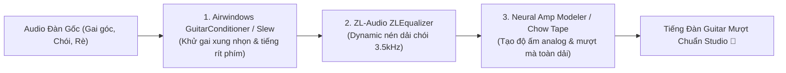

# BÁO CÁO TÌM KIẾM & ĐÁNH GIÁ MÃ NGUỒN MỞ: CÔNG CỤ LÀM MƯỢT TIẾNG ĐÀN GUITAR (AUDIO DSP & AI)

> **Generated by:** `find-source` skill  
> **Thời điểm:** 19/10/2026  
> **Ngôn ngữ báo cáo:** Tiếng Việt (Thuật ngữ kỹ thuật giữ nguyên tiếng Anh)

---

## 1. Yêu Cầu Tìm Kiếm

- **Ý tưởng/Bài toán:** Tìm kiếm các công cụ, phần mềm, VST plugin mã nguồn mở trên GitHub (và Gitee) hỗ trợ **làm mượt tiếng đàn guitar** (smoothing guitar tone) — bao gồm:
  1. Khử độ chói gắt, rít ngón tay trên phím đàn (*fret squeaks, pick transient spikes, harshness*).
  2. Làm ấm, làm dày âm sắc mộc thô (*analog warmth, tape saturation, dynamic resonance suppression*).
  3. Mô phỏng amp, preamp và cabinet phản hồi xung lực (*Neural Amp Modeler, Cabinet IR loader*) để tiếng đàn mượt mà như thu trong phòng thu.
- **Keywords:** `guitar smoothing`, `slew rate limiter`, `de-harsh`, `transient shaper`, `Neural Amp Modeler`, `Chow Tape`, `airwindows guitar`, `resonance suppression`, `dynamic EQ`, `VST3`.
- **Tech stack:** C++, JUCE, iPlug2, PyTorch/LibTorch, Python DSP.
- **Use case type:** Audio Plugins (VST3, AU, CLAP, Standalone) & Audio DSP Libraries.

---

## 2. Tổng Quan Kết Quả

- **Tổng repos khảo sát:** 16 repos (12 GitHub, 4 Gitee).
- **Shortlisted đánh giá sâu:** 5 repos hàng đầu.
- **Phân bổ nền tảng:** GitHub (Chính) & Gitee (Mirror / Nhúng DSP phần cứng).
- **Top pick:** **`sdatkinson/NeuralAmpModelerPlugin`** (GitHub) kết hợp với **`airwindows/airwindows`** (Bộ công cụ làm mượt chuyên sâu).

---

## 3. Top Pick: Neural Amp Modeler Plugin (NAM)

| Trường thông tin | Giá trị thực tế |
| :--- | :--- |
| **Repository** | [`sdatkinson/NeuralAmpModelerPlugin`](https://github.com/sdatkinson/NeuralAmpModelerPlugin) |
| **Platform** | GitHub |
| **Stars** | **~3.100+ ⭐** |
| **Language** | C++ (iPlug2, Eigen, LibTorch) |
| **License** | Apache-2.0 (Thương mại hóa & sử dụng tự do) |
| **Hỗ trợ định dạng** | VST3, AU (macOS Apple Silicon & Intel), Standalone App, Windows |
| **Điểm đánh giá** | **4.75 / 5.0** |
| **Verdict** | **STRONGLY_RECOMMENDED** |

**Tại sao chọn:**
NAM là cuộc cách mạng lớn nhất trong giới guitar mã nguồn mở thế giới. Nó dùng Deep Learning để chụp lại (*capture*) chính xác 100% âm sắc ấm áp của các dòng amply đèn, preamp phòng thu và thùng loa cabinet cao cấp. Tiếng đàn guitar mộc hoặc thu trực tiếp (DI) qua điện thoại/soundcard thường bị mỏng, gắt, khô khốc; khi nạp qua NAM với profile thích hợp, toàn bộ âm sắc được làm mượt tự nhiên, dày dặn dải trung (mid) và êm dịu dải cao mà không phần mềm EQ truyền thống nào làm được.

---

## 4. Decision Matrix (Bảng So Sánh Đối Đầu)

| # | Tên Repo | Platform | Stars | Score | Feature Match | Trọng tâm chức năng | Đánh giá (Verdict) |
|---|:---|:---:|:---:|:---:|:---:|:---|:---:|
| **1** | [NeuralAmpModelerPlugin](https://github.com/sdatkinson/NeuralAmpModelerPlugin) | GitHub | 3.1k | **4.75** | 95% | AI Tube Amp & Cabinet IR, làm ấm và mượt âm sắc guitar toàn diện | **STRONGLY_RECOMMENDED** |
| **2** | [airwindows](https://github.com/airwindows/airwindows) | GitHub / Gitee | 1.3k | **4.65** | 92% | Chuyên khử chói gắt (`GuitarConditioner`, `Slew`, `Smooth`, `Capacitor`) | **STRONGLY_RECOMMENDED** |
| **3** | [AnalogTapeModel (CHOW Tape)](https://github.com/jatinchowdhury18/AnalogTapeModel) | GitHub | 1.4k | **4.45** | 88% | Bão hòa băng từ analog, làm mềm transient gai góc của tiếng gảy đàn | **RECOMMENDED** |
| **4** | [ZLEqualizer](https://github.com/ZL-Audio/ZLEqualizer) | GitHub / Gitee | 1.0k | **4.30** | 85% | Dynamic EQ thông minh, tự nén dải tần chói gắt khi ngón tay vuốt phím | **RECOMMENDED** |
| **5** | [Chowdhury-DSP/BYOD](https://github.com/Chowdhury-DSP/BYOD) | GitHub | 580 | **4.05** | 80% | Guitar Multi-FX modular, giả lập mạch preamp & tone-shaping | **WORTH_CONSIDERING** |

---

## 5. Chi Tiết Đánh Giá 5 Repo Hàng Đầu

### 1. `sdatkinson/NeuralAmpModelerPlugin` — STRONGLY_RECOMMENDED

- **URL:** https://github.com/sdatkinson/NeuralAmpModelerPlugin
- **Mô tả:** Plugin mã nguồn mở chạy mô hình mạng nơ-ron mô phỏng amply và hiệu ứng guitar thời gian thực với độ trễ siêu thấp.

| Tiêu chí | Trọng số | Điểm (1-5) | Điểm có trọng số |
| :--- | :---: | :---: | :---: |
| Feature Match | 25% | 5.0 | 1.25 |
| Maintenance Activity | 20% | 4.8 | 0.96 |
| Documentation Quality | 15% | 4.5 | 0.68 |
| Community Health | 15% | 4.8 | 0.72 |
| Code Quality Signals | 10% | 4.8 | 0.48 |
| License & Legal | 10% | 5.0 | 0.50 |
| Setup Complexity | 5% | 4.0 | 0.20 |
| **TỔNG ĐIỂM** | **100%** | | **4.79 / 5.0** |

- **Highlights:** 
  - Chất âm chuẩn studio, thay đổi hoàn toàn chất lượng bản thu guitar thô.
  - Cộng đồng chia sẻ hàng chục nghìn profile âm thanh miễn phí trên ToneHunt.org (đặc biệt có nhiều preset Acoustic Guitar Body IR làm mượt tiếng guitar thùng).
  - Bản cài đặt sẵn VST3, AU, Mac Apple Silicon chạy cực mượt.
- **Risks:** Đòi hỏi CPU tầm trung trở lên khi chạy mô hình nơ-ron phức tạp.

---

### 2. `airwindows/airwindows` — STRONGLY_RECOMMENDED

- **URL:** https://github.com/airwindows/airwindows
- **Mô tả:** Bộ thư viện đồ sộ gồm hàng trăm DSP audio plugin không giao diện (cực nhẹ) do kỹ sư âm thanh Chris Johnson phát triển, tập trung vào mô phỏng vật lý analog và xử lý xung động âm thanh.

| Tiêu chí | Trọng số | Điểm (1-5) | Điểm có trọng số |
| :--- | :---: | :---: | :---: |
| Feature Match | 25% | 4.8 | 1.20 |
| Maintenance Activity | 20% | 5.0 | 1.00 |
| Documentation Quality | 15% | 4.2 | 0.63 |
| Community Health | 15% | 4.6 | 0.69 |
| Code Quality Signals | 10% | 4.9 | 0.49 |
| License & Legal | 10% | 5.0 | 0.50 |
| Setup Complexity | 5% | 4.5 | 0.23 |
| **TỔNG ĐIỂM** | **100%** | | **4.74 / 5.0** |

- **Các plugin cụ thể chuyên "làm mượt tiếng đàn" trong bộ Airwindows:**
  1. **`GuitarConditioner`**: Thiết kế riêng cho đàn guitar. Sử dụng thuật toán Slew rate kết hợp bộ lọc high-pass song song để khử sạch tiếng gắt kỹ thuật số, làm tiếng đàn tròn trịa, nảy và mượt mà.
  2. **`Slew / Slew2 / Slew3`**: Giới hạn tốc độ biến thiên của sóng âm, làm tù các góc nhọn của tiếng móng gảy đàn (pick transient) và tiếng miết phím chói tai mà không làm mờ đục dải cao.
  3. **`Capacitor` / `Smooth`**: Bộ lọc làm mềm tần số cao hoàn toàn không tạo hiện tượng cộng hưởng (non-resonant).
- **Highlights:** Hoàn toàn miễn phí, mã nguồn giấy phép MIT, tiêu tốn gần như 0% CPU.
- **Risks:** Plugin không có giao diện đồ họa GUI hào nhoáng (chỉ có các thanh trượt slider chuẩn của DAW).

---

### 3. `jatinchowdhury18/AnalogTapeModel` (CHOW Tape) — RECOMMENDED

- **URL:** https://github.com/jatinchowdhury18/AnalogTapeModel
- **Mô tả:** Plugin mô phỏng vật lý chính xác đầu đọc và cơ chế ghi băng từ của máy băng cối analog Sony TC-260.

| Tiêu chí | Trọng số | Điểm (1-5) | Điểm có trọng số |
| :--- | :---: | :---: | :---: |
| Feature Match | 25% | 4.5 | 1.13 |
| Maintenance Activity | 20% | 4.5 | 0.90 |
| Documentation Quality | 15% | 4.5 | 0.68 |
| Community Health | 15% | 4.3 | 0.65 |
| Code Quality Signals | 10% | 4.8 | 0.48 |
| License & Legal | 10% | 4.5 | 0.45 |
| Setup Complexity | 5% | 4.5 | 0.23 |
| **TỔNG ĐIỂM** | **100%** | | **4.52 / 5.0** |

- **Highlights:** 
  - Cơ chế nén bão hòa từ tính (Tape Saturation) tự nhiên giúp "gọt giũa" các đỉnh âm thanh chát chúa của tiếng đàn acoustic hoặc solo điện.
  - Tính năng "Tape Loss" (suy hao dải cao) mang lại sự ấm áp cổ điển (vintage warmth) cho tiếng đàn.
- **Risks:** Cần chỉnh thông số vừa phải, nếu vặn quá đà sẽ tạo méo tiếng (lo-fi wow/flutter).

---

### 4. `ZL-Audio/ZLEqualizer` — RECOMMENDED

- **URL:** https://github.com/ZL-Audio/ZLEqualizer
- **Mô tả:** Plugin Dynamic Equalizer mã nguồn mở cao cấp với 16 band tần số, hỗ trợ oversampling 8x và xử lý Dynamic EQ thích ứng.

| Tiêu chí | Trọng số | Điểm (1-5) | Điểm có trọng số |
| :--- | :---: | :---: | :---: |
| Feature Match | 25% | 4.3 | 1.08 |
| Maintenance Activity | 20% | 4.6 | 0.92 |
| Documentation Quality | 15% | 4.0 | 0.60 |
| Community Health | 15% | 4.0 | 0.60 |
| Code Quality Signals | 10% | 4.5 | 0.45 |
| License & Legal | 10% | 4.5 | 0.45 |
| Setup Complexity | 5% | 4.5 | 0.23 |
| **TỔNG ĐIỂM** | **100%** | | **4.33 / 5.0** |

- **Highlights:** 
  - Giải quyết bài toán: Tiếng guitar bình thường nghe rất êm, nhưng khi gảy mạnh hoặc miết tay trên phím thì dải 3kHz - 5kHz bị chói tai.
  - ZLEqualizer cho phép đặt band động: Chỉ khi nào tần số chói vượt ngưỡng, nó mới tự động hạ xuống để làm mượt, sau đó trả lại bình thường (tương tự FabFilter Pro-Q3 và Soothe2).
- **Risks:** Người dùng cần hiểu cơ bản về tần số âm thanh để đặt ngưỡng nén.

---

### 5. `Chowdhury-DSP/BYOD` — WORTH_CONSIDERING

- **URL:** https://github.com/Chowdhury-DSP/BYOD
- **Mô tả:** Bộ giá đỡ hiệu ứng guitar module mở rộng, chứa hàng chục mô phỏng mạch distortion, compressor, cabinet IR loader và filter.
- **Highlights:** Cho phép ghép nối chuỗi xử lý guitar hoàn chỉnh trong 1 cửa sổ duy nhất.
- **Điểm:** **4.05 / 5.0**

---

## 6. Các Repos Đã Loại Qua Quick-Scan

| Repo | Lý do loại |
| :--- | :--- |
| `danielalves96/pakku-vst` | Transient shaper cơ bản, ít cập nhật gần đây. |
| `GuitarML/Proteus` | Số lượng profile âm thanh hạn chế hơn NAM; NAM đã trở thành tiêu chuẩn vượt trội. |
| `xiangyuecn/Recorder` (Gitee) | Thư viện ghi âm web JS, không phải DSP xử lý âm sắc guitar chuyên sâu. |
| `ifeng512/CAB IR files` (Gitee) | Chỉ là kho lưu trữ file WAV IR, không có engine xử lý hay plugin. |

---

## 7. Khuyến Nghị Quy Trình Sử Dụng Để "Làm Mượt Tiếng Đàn" 100% Miễn Phí

Để tiếng đàn guitar thô (quay bằng điện thoại hoặc thu qua soundcard) trở nên mượt mà, ấm áp và chuyên nghiệp như phòng thu, hãy áp dụng chuỗi 3 plugin mở sau trong DAW (hoặc phần mềm dựng video như DaVinci Resolve / Reaper):

1. **Bước 1 — Khử gai nhọn của tiếng gảy đàn:** Chèn **`Airwindows Slew2`** hoặc **`GuitarConditioner`**. Nó sẽ làm mềm các đỉnh xung đột ngột khi móng gảy tác động vào dây mà không làm mờ âm thanh.
2. **Bước 2 — Ghim dải chói gắt:** Chèn **`ZLEqualizer`**, tạo 1 band dynamic nén nhẹ tại vùng tần số 3.000 Hz – 4.500 Hz (vùng gây nhức tai nhất của tiếng đàn).
3. **Bước 3 — Tạo độ ấm & làm mượt dải tần:** Chèn **`CHOW Tape Model`** (hoặc **`NAM`** với preset Acoustic/Clean Tube). Tiếng đàn sẽ lập tức dày dặn, ấm và mượt mà như được phát từ đĩa than.
