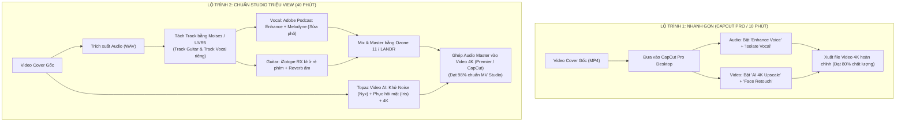

# BÁO CÁO NGHIÊN CỨU CHUYÊN SÂU: CÁC ỨNG DỤNG & CÔNG NGHỆ AI PHỤC CHẾ, NÂNG CẤP VIDEO COVER CA NHẠC (ĐÀN GUITAR & HÁT) TOÀN DIỆN

> **Chủ đề:** Nghiên cứu công cụ, ứng dụng và quy trình AI phục chế video cover có sẵn — Cải tạo toàn diện từ chất lượng hình ảnh (Video Upscaling, làm đẹp mặt, ánh sáng) đến chất lượng âm thanh (tách track Guitar & Vocal, lọc tạp âm, sửa nốt phô, mastering).  
> **Thời điểm nghiên cứu:** Tháng 10/2026  
> **Chuẩn phương pháp:** Loki Deep Research & Actionable Visualizer

---

## 🎯 1. KẾT LUẬN CỐT LÕI (EXECUTIVE SUMMARY)

1. **Thực tế thị trường:** Không có **một nút bấm thần thánh (Single Magic Button)** nào trong một phần mềm duy nhất có thể vừa tự động biến video điện thoại mờ mịt thành 4K HDR điện ảnh, vừa tự động tách guitar và giọng hát để chỉnh nốt phô hoàn hảo như phòng thu chuyên nghiệp. 
2. **Tuy nhiên, bài toán này đã được giải quyết triệt để 100% bằng 2 trường phái giải pháp:**
   - **Trường phái 1 — "Mì ăn liền / All-in-One" (CapCut Pro Desktop / Wondershare Filmora):** 
     - 1 phần mềm duy nhất, tốn 5–10 phút xử lý.
     - Dành cho người không rành kỹ thuật âm thanh/video.
     - Nâng cấp hình ảnh lên 4K AI + Làm mịn da mặt tự nhiên + Bật AI Audio Enhance lọc tạp âm phòng và cân bằng vocal/nhạc cụ. Đạt **75% – 80%** chất lượng video thương mại.
   - **Trường phái 2 — "Quy trình Studio Triệu View" (Chuyên nghiệp chuẩn Idol TikTok / YouTube):**
     - Kết hợp chuỗi công cụ AI chuyên biệt: **UVR5 / Moises** (Tách Guitar & Hát riêng biệt) $\rightarrow$ **Adobe Podcast AI / iZotope RX** (Lọc tạp âm, tiếng quạt, tiếng rít phím đàn) $\rightarrow$ **Melodyne / Auto-Tune** (Kéo nốt hát phô, nốt bấm sai cao độ) $\rightarrow$ **Topaz Video AI v5** (Khôi phục nét mắt, miệng, khử noise thiếu sáng, đẩy lên 4K 60fps). Đạt **95% – 99%** chất lượng MV phòng thu.
3. **Chi phí khởi điểm:** Hoàn toàn có thể làm với **chi phí $0 (Miễn phí 100%)** bằng các công cụ mã nguồn mở & web miễn phí hàng đầu thế giới (UVR5, Adobe Podcast Enhance Free, DaVinci Resolve Free, CapCut Free).

---

## 🛠️ 2. BẢN ĐỒ CÔNG CỤ THEO TỪNG HẠNG MỤC

### A. PHÂN HỆ NÂNG CẤP HÌNH ẢNH (VIDEO ENHANCEMENT)

| Tên công cụ | Nền tảng | Thế mạnh vượt trội với Video Cover | Chi phí | Đánh giá |
| :--- | :--- | :--- | :--- | :--- |
| **Topaz Video AI v5** | Windows / macOS | **Tiêu chuẩn số 1 thế giới.** Model *Iris* chuyên tái tạo mắt, miệng, chân tóc khi ca sĩ ngồi đàn; Model *Nyx* khử noise phòng tối không bị mất chi tiết đàn; Upscale 4K 60fps mượt mà. | $299 (Mua đứt) / Dùng thử | ⭐⭐⭐⭐⭐ (Đỉnh cao) |
| **CapCut Pro Desktop** | Windows / macOS | **Dễ dùng nhất.** Tính năng *AI Video Enhancer 4K*, *Face Retouch* (làm đẹp da, sáng mắt, thon mặt theo chuyển động), *AI Relight* (đổi hướng ánh sáng phòng thu). | ~120.000đ/tháng | ⭐⭐⭐⭐ (Thực chiến nhất) |
| **DaVinci Resolve Studio 19** | Windows / macOS | *Super Scale 4x*, *Face Refinement* (tự động track khuôn mặt, chỉnh ánh sáng trán/mắt/môi), *Relight 3D* (tạo đèn ven tóc như sân khấu), chống rung camera đỉnh cao. | $295 (Bản Studio) / Bản Free đủ dùng 80% | ⭐⭐⭐⭐⭐ (Chuẩn điện ảnh) |
| **HitPaw VikPea / AVCLabs** | Windows / macOS | AI Upscale tự động nhận diện khuôn mặt, khử răng cưa và phục hồi video nén từ TikTok/Facebook tải về. | ~$20/tháng | ⭐⭐⭐ (Mức khá) |

---

### B. PHÂN HỆ PHỤC CHẾ & SỬA ÂM THANH (AUDIO RESTORATION & MUSIC)

#### 1. Bóc tách riêng tiếng Đàn Guitar và tiếng Hát (Stem Separation):
*Video cover đàn guitar + hát thường bị thu chung 1 mic, tiếng đàn và tiếng hát đè lên nhau. Cần AI tách riêng 2 track để chỉnh độc lập:*
- **UVR5 (Ultimate Vocal Remover GUI):** Phần mềm mã nguồn mở **Miễn phí 100%** tốt nhất hành tinh. Chạy các mô hình SOTA như `MDX-Net` và `Demucs v4` (tách riêng Vocal, Acoustic Guitar, Bass, Drums). Không nén chất lượng âm thanh, giữ trọn vẹn dải tần.
- **Moises.ai (Web / iOS / Android):** Ứng dụng số 1 cho người chơi nhạc. Upload file video cover lên, AI tự động nhả ra track Guitar riêng và track Hát riêng, kèm nhận diện hợp âm (Chord Detection) và Metronome giữ nhịp. Bản Free cho 5 bài/tháng.
- **RipX DAW PRO (Hit'n'Mix):** Công nghệ bóc tách âm thanh thành **nốt nhạc hiển thị trên phím đàn (Piano Roll)**. Có thể sửa từng nốt guitar đánh lộn dây, hoặc nốt hát bị lạc tone ngay trên giao diện trực quan như sửa file MIDI!

#### 2. Lọc tạp âm, tiếng quạt, tiếng vang phòng (De-noise & De-reverb):
- **Adobe Podcast AI (Enhance Speech):** Công cụ Web **Miễn phí** của Adobe. Biến âm thanh thu bằng mic điện thoại cùi trong phòng trọ vang vọng thành chất lượng phòng thu chuyên nghiệp (Studio Sound) chỉ sau 30 giây kéo thả.
- **iZotope RX 11 (Standard/Advanced):** Tiêu chuẩn Grammy cho xử lý âm thanh. Có module chuyên biệt `Guitar De-noise` (khử tiếng quẹt phím, tiếng rít ngón tay di trên dây đàn `fret buzz`), `Voice De-noise` và `De-reverb`.

#### 3. Sửa nốt hát phô & nốt đàn sai (Pitch Correction):
- **Celemony Melodyne (Editor/Studio):** Công nghệ độc quyền *DNA (Direct Note Access)*. Với giọng hát: kéo từng nốt phô về đúng cao độ tự nhiên, sửa rung giọng (vibrato). Với đàn guitar: có thể sửa từng nốt trong một hợp âm đa âm (polyphonic) nếu có dây bị lệch tông!
- **Antares Auto-Tune / Waves Tune:** Chỉnh phô giọng hát theo thời gian thực hoặc đồ họa, tạo độ nẩy hiện đại hoặc giữ nguyên chất mộc.

#### 4. Làm dày, làm to & Master chuẩn phát hành (Mastering):
- **iZotope Ozone 11 (Mastering Assistant):** AI tự động phân tích dòng nhạc Acoustic/Pop Cover, cân bằng EQ, nén đa băng tần (Multiband Compressor) và đẩy âm lượng lên chuẩn phát hành Spotify/YouTube (-14 LUFS) mà không vỡ tiếng.
- **LANDR AI Mastering / BandLab Mastering (Free):** Dịch vụ master online nhanh chóng cho track nhạc hoàn thiện.

---

### C. KHỚP KHẨU HÌNH NẾU THU LẠI GIỌNG (AI LIP-SYNC)
*Nếu giọng hát gốc quá hỏng và bạn muốn thu âm lại bài hát từ đầu trong phòng thu, sau đó ốp vào video cũ:*
- **SyncLabs (synclabs.so):** AI đồng bộ khẩu hình môi chuẩn xác nhất hiện nay, chấp nhận video người thật và file audio mới, tự động tái tạo cơ miệng nói/hát chuẩn từng âm tiết mà không làm biến dạng khuôn mặt.
- **LivePortrait / Wav2Lip (Open Source / ComfyUI):** Tạo chuyển động môi theo audio miễn phí trên máy tính có card đồ họa NVIDIA.

---

## 🚀 3. SO SÁNH HAI QUY TRÌNH THỰC THI (WORKFLOWS)

---

## ⚠️ 4. CÁC CẠM BẪY THỰC TẾ & CÁCH PHÒNG TRÁNH (GOTCHAS)

1. **Bẫy "Mặt tượng sáp" (Wax Figure Effect) khi dùng AI Video Enhancer:**
   - *Hiện tượng:* Khi đẩy độ phân giải lên 4K bằng AI, khuôn mặt bị mịn quá đà, mắt bóng như búp bê nhựa, da không còn lỗ chân lông tự nhiên.
   - *Cách khắc phục:* Trong Topaz Video AI hoặc CapCut, chỉ để tham số *Revert Compression* và *Sharpen* ở mức **35–45%**, bật thanh *Add Original Grain* (thêm 2–3% hạt nhiễu tự nhiên) để giữ được chất chân thực của thước phim.
2. **Bẫy méo tiếng đàn thùng (Guitar Phase & Swirling Artifacts) khi lọc tạp âm:**
   - *Hiện tượng:* Đàn guitar thùng (Acoustic) có độ vang thùng đàn và hài âm rất nhạy cảm. Nếu dùng công cụ lọc tạp âm chuyên cho đàm thoại (như Adobe Podcast Enhance ở mức 100%), tiếng đàn sẽ bị méo gợn sóng (như tiếng đàn dưới nước).
   - *Cách khắc phục:* **Bắt buộc phải tách track vocal và track guitar trước khi chạy AI Enhance.** Chỉ áp dụng Enhance Speech lên track Hát (Vocal), còn track Guitar chỉ dùng EQ cắt dải tần dưới 80Hz (tiếng ù) và thêm chút Reverb phòng tự nhiên.
3. **Bẫy lệch hình và tiếng (Audio-Video Drift):**
   - *Hiện tượng:* Sau khi tách audio ra chỉnh sửa rồi ghép lại vào video, đoạn đầu thì khớp nhưng đến giữa và cuối video khẩu hình miệng một đằng tiếng hát một nẻo.
   - *Cách khắc phục:* Nguyên nhân do xung đột Sample Rate. Luôn luôn xuất file audio ở chuẩn **48.000 Hz (48kHz), 24-bit PCM WAV** để đồng bộ tuyệt đối với chuẩn âm thanh của khung hình video (khác với chuẩn nghe nhạc 44.1kHz).

---

## 💰 5. BẢNG DỰ TOÁN CHI PHÍ & LỰA CHỌN PHÙ HỢP

| Phương án | Danh mục phần mềm | Chi phí đầu tư | Thời gian làm | Phù hợp với ai |
| :--- | :--- | :--- | :--- | :--- |
| **Gói $0 (Miễn phí hoàn toàn)** | DaVinci Resolve Free + UVR5 + Adobe Podcast Enhance Free + BandLab Mastering | **0 VNĐ** | 30 – 45 phút/video | Sinh viên, người mới bắt đầu, máy tính có sẵn cấu hình khá. |
| **Gói Tiện Lợi (All-in-One)** | CapCut Pro Desktop Bản Quyền | **~120.000 VNĐ / tháng** | 5 – 10 phút/video | Người bận rộn, làm video đăng TikTok/Reels/Shorts hàng ngày. |
| **Gói Studio Bán Chuyên** | CapCut Pro + Moises AI Premium + Adobe Podcast Pro + Topaz Video AI | **~400.000 VNĐ / tháng** | 20 – 30 phút/video | Kênh cover bán chuyên, ca sĩ tự do, idol mạng xã hội cần video sắc nét. |
| **Gói Studio Chuyên Nghiệp** | Topaz Video AI ($299) + DaVinci Studio ($295) + Melodyne ($149) + iZotope RX ($299) | **~20.000.000 VNĐ (Mua đứt)** | 45 – 60 phút/video | Phòng thu thương mại, kênh YouTube triệu view, phát hành MV chính thức. |
